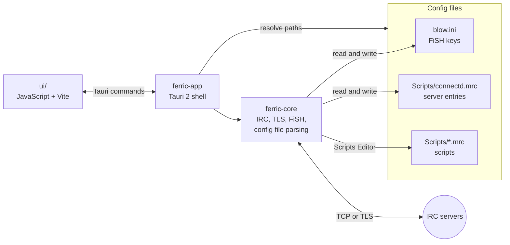

<div align="center">

# Ferric

**A Rust and Tauri 2 IRC client with a classic look and classic habits.**

It reads your server list from `connectd.mrc`, keeps FiSH keys in `blow.ini`, and speaks FiSH.


[Features](#features) · [Quick start](#quick-start) · [How it fits together](#how-it-fits-together) · [Configuration](#configuration) · [Security](#security) · [Status](#project-status) · [Repository index](index.md)

</div>

---

## At a glance

- **Bring your existing setup.** Server entries come from `connectd.mrc`, FiSH keys from `blow.ini`. No import step.
- **FiSH built in.** Messages to a target with a stored key are encrypted; incoming FiSH messages are decrypted.
- **Classic look and habits.** Right-click menus, nick colors by channel mode, an Options dialog with a category tree, and the Alt+O and Alt+R shortcuts.
- **Native core.** Connections, IRC parsing, FiSH, and config file handling are plain Rust in the `ferric-core` crate.

## Features

| Area | What you get |
|---|---|
| **IRC** | Multiple networks, channels, private conversations, nick lists, unread counts, and highlights. IRC color and formatting codes are rendered. |
| **TLS** | Servers with self-signed certificates can be allowed in Options. The certificate is trusted on the first connect and its fingerprint is stored. Later connects are refused if the certificate changed. See [Security](#security). |
| **FiSH** | ECB by default. A key stored with the `cbc:` prefix sends in CBC. Incoming CBC messages are recognized by their `+OK *` or `mcps *` prefix, independent of the key. Key exchange via DH1080 for private queries. Manage keys in **Tools → FiSH key manager** or with `/fish`, `/keys`, and `/delkey`. |
| **Context menus** | Right-click menus for the sidebar, the status window, channels, queries, the nick list, chat senders, and the menu bar. |
| **Nick colors** | Nick list and chat names follow the channel mode (`~`, `&`, `@`, `%`, `+`), first match wins. |
| **Queries** | Double-click a nick or use `/query <nick> [message]` to open a private conversation. `/close` or the close button ends it. |
| **Options** | **Alt+O** opens the Options dialog with a category tree: Display (themes, nick list, switchbar), Mouse (double-click actions), Logging (session chat logs), Identd (built-in RFC 1413 daemon), and Proxy (SOCKS5 and HTTP CONNECT). |
| **Scripts Editor** | **Alt+R** opens an editor for `.mrc` files in the `Scripts` folder. Line numbers, backup on save, and external conflict detection. Scripts you load are loaded again at the next start (listed in `loaded-scripts.txt` next to `connectd.mrc`). The interpreter runs a subset of aliases and events; not every command is supported. |
| **Server manager** | **Tools → Server manager…** lists the `server` lines of `connectd.mrc`. Add, edit, enable, disable, or delete servers; comments and other lines stay as they are. A save is refused when the file changed on disk. |
| **Interface** | Light and dark themes, per-area fonts (**View → Font...**), an optional nick list, a Switchbar toggle, and a notes window (**View → Notes**). |

<details>
<summary><b>Commands</b></summary>

| Command | Effect |
|---|---|
| `/join #chan` (`/j`) | Join a channel. A missing `#` is added. |
| `/part [#chan]` (`/p`) | Leave the given or the active channel. |
| `/query nick [message]` (`/q`) | Open a private conversation, optionally with a first message. |
| `/close [target]` | Close the given or the active window. |
| `/clear` | Clear the active window. |
| `/raw line` | Send a raw IRC line. |
| `/scriptload file.mrc` | Load aliases from a file in the `Scripts` folder for this session. Invoke a loaded alias with `/name arguments`. Requires an active network and buffer. |
| `/scriptunload file.mrc` | Unload aliases loaded from that file in this session. |
| `/connectd` (`/load`) | Reload server entries from `connectd.mrc`. |
| `/fish [target] key` (`/key`, `/keys`, `/blowfish`) | Store a FiSH key in `blow.ini`. Without arguments, opens the key manager. |
| `/delkey [target]` | Delete a FiSH key from `blow.ini`. |

Any other line that starts with `/` is sent to the server as a raw IRC command.

</details>

---

## Quick start

### Windows

Prerequisites (check them with `.\build-exe.ps1 -Check`):
- **Node.js & npm**: `winget install OpenJS.NodeJS.LTS`
- **Rust & Cargo**: `winget install Rustlang.Rustup` (default toolchain: `stable-x86_64-pc-windows-msvc`)
- **Microsoft C++ Build Tools**: `winget install Microsoft.VisualStudio.2022.BuildTools --override "--passive --wait --add Microsoft.VisualStudio.Workload.VCTools --includeRecommended"`
- **WebView2 Runtime**: `winget install Microsoft.EdgeWebView2Runtime` (usually pre-installed on Windows 11)

```powershell
.\build-exe.ps1                      # build the UI, then the release executable
.\target\release\ferric-app.exe      # start Ferric
```

More options:
```powershell
.\build-exe.ps1 -Check               # check Windows prerequisites only (no build)
.\build-exe.ps1 -Debug               # debug build instead of release
.\build-exe.ps1 -Test                # run 'cargo test --workspace' before building
.\build-exe.ps1 -Clean               # clean previous build artifacts
.\build-exe.ps1 -Reinstall           # force clean install of npm dependencies
.\build-exe.ps1 -Run                 # start Ferric directly after a successful build
```

### Linux

Prerequisites: **Rust and Cargo**, **Node.js and npm**, and the Tauri development libraries:
- **Debian/Ubuntu**: `sudo apt-get install -y libwebkit2gtk-4.1-dev libayatana-appindicator3-dev librsvg2-dev libssl-dev pkg-config build-essential`
- **Fedora**: `sudo dnf install -y webkit2gtk4.1-devel libappindicator-gtk3-devel librsvg2-devel openssl-devel`
- **Arch**: `sudo pacman -S --needed webkit2gtk-4.1 libayatana-appindicator librsvg openssl`

```bash
chmod +x build-linux.sh
./build-linux.sh                     # build the UI, then the release binary
./target/release/ferric-app          # start Ferric
```

More options:
```bash
./build-linux.sh --debug             # debug build instead of release
./build-linux.sh --test              # run 'cargo test --workspace' before building
./build-linux.sh --clean             # clean previous build artifacts
./build-linux.sh --reinstall         # force clean install of npm dependencies
./build-linux.sh --run               # start Ferric directly after a successful build
```

<details>
<summary><b>Manual build and core tests</b></summary>

```bash
cd ui
npm ci
npm run build
cd ..
cargo build --release -p ferric-app
cargo test -p ferric-core
```

| Output | Content |
|---|---|
| `ui/dist/` | The built interface that the app loads (`frontendDist` in `tauri.conf.json`). |
| `target/release/ferric-app.exe` | The Windows executable (or `ferric-app` on Linux). |

</details>

---

## How it fits together



| Part | Role |
|---|---|
| `crates/ferric-core` | Connections, IRC protocol and formatting, TLS, FiSH, `blow.ini` and `connectd.mrc` parsing, script files. No Tauri dependency. |
| `crates/ferric-app` | The Tauri 2 desktop shell: finds the config files and exposes the core to the UI. |
| `ui/` | The JavaScript interface, built with Vite. |

---

## Configuration

Ferric uses two files:

| File | Contents |
|---|---|
| `blow.ini` | FiSH keys. |
| `Scripts\connectd.mrc` | Server entries. The Server manager writes this file; you can also edit it by hand. |

Both files are looked up in the same places, in this order, and the first match wins:

1. The folder in the `FERRIC_CONFIG_DIR` environment variable, if set.
2. The Ferric project folder: the folder of `ferric-app.exe`, or two levels up when the executable runs from `target\release` (the repository root).
3. The app configuration folder of your Windows user account.

Ferric never searches the working directory or parent folders. A missing `connectd.mrc` is created in `Scripts\` of the project folder on the first save; a missing `blow.ini` is created there on the first saved FiSH key.

Next to `connectd.mrc` Ferric keeps two small files: `ferric-servers.txt` (server order and network names) and `ferric-tls-pins.txt` (pinned certificate fingerprints).

> [!IMPORTANT]
> These files can hold passwords and keys. Keep them out of the repository and never share them.

### Example files

The `examples` folder has templates for both files. Copy them to the locations above and remove the `.example` ending:

- `examples\connectd.mrc.example` becomes `Scripts\connectd.mrc`
- `examples\blow.ini.example` becomes `blow.ini`

Then edit the copies with your own servers and keys.

---

## Security

- **Certificates.** Normal TLS checks apply. For a server with a self-signed certificate, enable **Allow self-signed certificates** in Options. Ferric then trusts that certificate on the first connect and stores its fingerprint in `ferric-tls-pins.txt`. If the certificate changes later, the connect is refused until you remove the old pin.
- **Only keyed targets are encrypted.** A message is encrypted only when a FiSH key is stored for its target; everything else is plain IRC text.
- **A failed encryption sends nothing.** If FiSH encryption fails, Ferric reports `FiSH encryption failed; message was not sent`.
- **Your files stay private.** `blow.ini`, `connectd.mrc` and `ferric-tls-pins.txt` are local to your machine; see [Configuration](#configuration).

---

## Project status

**Early development.** Features and behavior may change.

- The Windows release build via `build-exe.ps1` and the Linux build via `build-linux.sh` are available.
- Display, Mouse, Logging, Identd, and Proxy pages in Options are functional.
- The script interpreter covers a subset of the classic script language; see the Scripts Editor row in [Features](#features).

Repository navigation is summarized in [index.md](index.md).

## Repository map

- `crates/`
  - `ferric-app/` — Tauri application shell and platform integration.
  - `ferric-core/` — IRC protocol, TLS, file parsing, and FiSH implementation.
- `ui/` — Vite and JavaScript interface.
- `Scripts/` — script files that Ferric can load; the server list `connectd.mrc` is created here.
- `examples/` — templates for the local configuration files.
- [`index.md`](index.md) — repository entry point.
